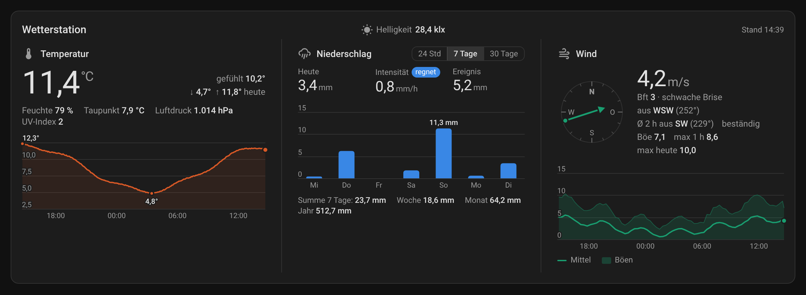
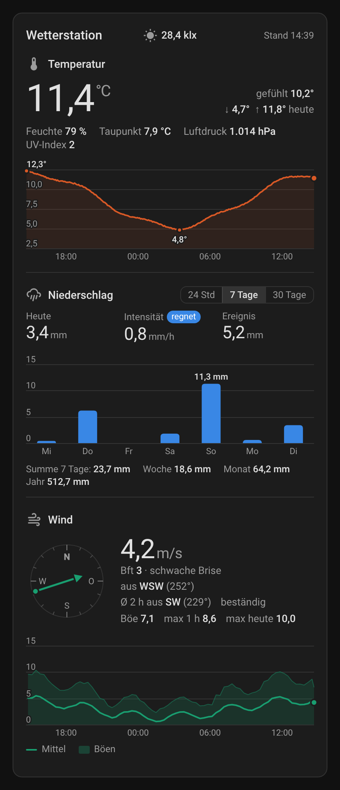
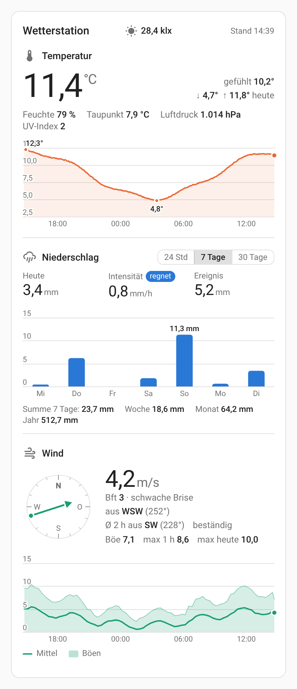

# Weather Station Card

Weather station card for Home Assistant: **temperature, precipitation and wind** in one card, each with its history. Pick your station's device and the card finds the sensors by itself. Built and tested with an Ecowitt GW1100A, but it works with any station whose sensors use the standard Home Assistant device classes.

**Read-only by design:** tapping a value only opens the more-info dialog. The card reads history and statistics but never calls a service.



## Examples

| Dark theme | Light theme |
|---|---|
|  |  |

## Features

- **Temperature:** large current value, feels-like, today's low/high, humidity, dew point, pressure and UV index, plus a 24 h curve with the minimum and maximum marked
- **Precipitation:** rain today, rain rate (with a "raining" badge while it rains) and the last rain event; bar chart switchable between **24 h / 7 days / 30 days**; totals for the period, week, month and year
- **Wind:** compass showing where the wind comes from, Beaufort scale, current gust, strongest gust of the last hour and of today; 24 h chart of average wind and gusts
- **Average wind direction** over the last 2 hours (configurable), weighted by wind speed, with a steadiness hint (steady / variable / shifting); calm periods don't count
- **Brightness** (illuminance) in the header, low-battery warning for the outdoor sensor
- Hover or tap a chart to read the values; charts also work with the keyboard (arrow keys)
- **Automatic sensor detection** from the selected device(s); every assignment can be overridden
- Visual editor, no YAML required; editor and card in German or English depending on your Home Assistant language
- Uses Home Assistant's long-term statistics (fast, also over 30 days); temperature, wind and the average direction fall back to the raw history where no statistics exist
- Follows the Home Assistant light and dark theme; wind in m/s, km/h, knots or mph
- Responsive: stacked on phones, three columns side by side on wide dashboards

## Installation

### HACS (recommended)

Installing via [HACS](https://hacs.xyz) is the recommended way: you get update notifications and the dashboard resource is registered automatically.

[](https://my.home-assistant.io/redirect/hacs_repository/?owner=pasimatics&repository=weather-station-card&category=plugin)

Click the button above, or add it manually:

1. Open **HACS** → three-dot menu → **Custom repositories**
2. Add `https://github.com/pasimatics/weather-station-card` with category **Dashboard**
3. Install **Weather Station Card** and reload the browser

### Manual

Only if you don't use HACS:

1. Copy `dist/weather-station-card.js` to `/config/www/weather-station-card/`
2. Add the resource `/local/weather-station-card/weather-station-card.js` (type: JavaScript module)

## Configuration

The card has a **visual editor**: add it via *Add card → Weather Station Card* (German: *Wetterstation*) and pick your weather station's device. All sensors are detected automatically. Under *Assign sensors manually* you can override any of them, for example if your station is split across several devices or you want a different sensor.

Minimal YAML:

```yaml
type: custom:weather-station-card
devices:
  - 0123456789abcdef0123456789abcdef   # device ID, easiest picked in the visual editor
```

With options and a manual override:

```yaml
type: custom:weather-station-card
name: Wetterstation
devices:
  - 0123456789abcdef0123456789abcdef
rain_range: 7d
wind_unit: km/h
wind_avg_hours: 2
pressure: sensor.gw1100a_relative_pressure
```

Without a device, only with entities:

```yaml
type: custom:weather-station-card
name: Garten
temperature: sensor.garden_temperature
humidity: sensor.garden_humidity
rain_today: sensor.rain_gauge_daily
wind_speed: sensor.anemometer_speed
wind_direction: sensor.anemometer_direction
```

Sections without sensors are simply not shown, e.g. a station without an anemometer gets no wind section.

### Options

| Option | Default | Description |
|---|---|---|
| `name` | device name | Card title; set to `""` to hide it |
| `devices` | – | List of device IDs; sensors are detected automatically. Several devices are possible (e.g. separate rain gauge and anemometer) |
| `hours_to_show` | `24` | History shown for temperature and wind, 6–168 hours |
| `rain_range` | `24h` | Rain period selected when the card loads: `24h`, `7d` or `30d` |
| `wind_unit` | `auto` | `auto` (as the sensor reports it), `m/s`, `km/h`, `kn` or `mph` |
| `wind_avg_hours` | `2` | Period for the average wind direction, 0.5–24 hours; `0` turns it off |

### Sensors

Every sensor can be set directly at the top level of the card config. A sensor set here wins over the automatic detection.

| Key | Typical sensor | Shown as |
|---|---|---|
| `temperature` | outdoor temperature | large value + curve |
| `feels_like` | feels-like temperature | value |
| `dewpoint` | dew point | value |
| `humidity` | outdoor humidity | value |
| `pressure` | relative (sea-level) pressure | value |
| `uv_index` | UV index | value |
| `illuminance` | solar illuminance (lx) | header |
| `rain_today` | daily rain | "Today" |
| `rain_rate` | rain rate (mm/h) | "Rate" + "raining" badge |
| `rain_event` | rain event | "Event" |
| `rain_week` / `rain_month` / `rain_year` | weekly / monthly / yearly rain | totals |
| `rain_history` | a rain counter with statistics (`state_class`), preferably total rain | bar chart |
| `wind_speed` | wind speed | large value, Beaufort, chart |
| `wind_gust` | wind gust | value + chart |
| `wind_gust_max` | max daily gust | "max today" |
| `wind_direction` | wind direction (°) | compass + average direction |
| `battery` | battery binary sensor | low-battery warning |

### How the automatic detection works

The card looks at all sensors of the selected device(s) and assigns them by `device_class`, unit and name. Indoor sensors are skipped, outdoor sensors are preferred, relative pressure wins over absolute pressure, and helper values such as maximums or 10-minute averages are not mistaken for the live value. If a guess is wrong, override that single sensor in the editor.

### Average wind direction

Wind directions can't be averaged like normal numbers: 350° and 10° would give 180° (south) although the wind came from the north both times. The card therefore adds up the directions as vectors, weighted by the wind speed, so a strong wind counts more than a faint breeze and calm periods don't count at all. The length of the resulting vector tells how steady the wind was: at least 80 % is shown as *steady*, at least 50 % as *variable*, below that as *shifting*. If the average speed in the period is below 0.3 m/s, the card shows *calm* instead of a direction.

### Requirements

- Home Assistant 2024.8 or newer
- The recorder (enabled by default). The charts use long-term statistics, which Home Assistant keeps for sensors with a `state_class`; most weather integrations set it.

### Coming from `wetterstation-card`

The first version of this card was called `wetterstation-card`. That card type keeps working, so existing dashboards don't break. When you switch to the HACS version, remove the old manual resource (`/local/wetterstation-card/wetterstation-card.js`) so the card is not loaded twice, and optionally change `type:` to `custom:weather-station-card`.

## Deutsch

Wetterstations-Karte für Home Assistant mit Temperatur, Niederschlag und Wind in einer Karte, jeweils mit Verlauf. Im visuellen Editor wählst du nur das Gerät deiner Wetterstation aus, die Karte erkennt die passenden Sensoren selbst. Jede Zuordnung lässt sich unter „Sensoren manuell zuordnen“ überschreiben. Entwickelt und getestet mit einer Ecowitt GW1100A, funktioniert aber mit jeder Station, deren Sensoren die üblichen Home-Assistant-Geräteklassen verwenden.

Die Karte zeigt unter anderem gefühlte Temperatur, Tief/Hoch von heute, Luftfeuchte, Taupunkt, Luftdruck, UV-Index und Helligkeit. Beim Niederschlag gibt es ein Balkendiagramm über 24 Stunden, 7 oder 30 Tage, beim Wind Kompass, Beaufort, Böen und die nach Windstärke gewichtete mittlere Windrichtung der letzten 2 Stunden (einstellbar). Die Oberfläche ist auf Deutsch, bei anderer HA-Sprache auf Englisch. Empfohlene Installation über HACS (siehe oben). Die Karte ist eine reine Anzeige: Antippen öffnet nur das Info-Fenster, es werden keine Dienste aufgerufen. Der alte Kartentyp `custom:wetterstation-card` funktioniert weiterhin.
